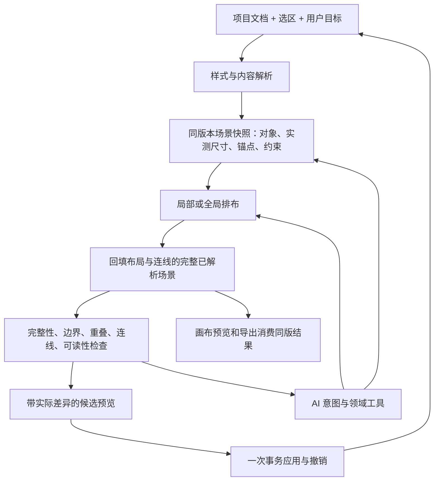

# 展示框排布、样式与 AI 调整：需求研究与智能化方案

日期：2026-10-15（Asia/Shanghai）。研究基线：`bfa609a1693f6edd27f99f7846111204b7003eec`。

本轮交付包含需求分析、实现核验和部分工作包落地；后文仍明确区分已经实现的基础与尚待实施的阶段。研究结合源码、真实 Chromium 操作、真实 SVG 渲染探针、针对性测试及官方技术资料；用户需求是待验证的产品假设，未冒充用户访谈结论。

## 1. 目标：让编辑器理解目标、尊重范围、证明结果

用户需要的是一张信息完整、读得清、能修改、能交付的毕业地图。三个方向应形成一个闭环：**样式决定内容占多大空间，排布决定空间如何分配，AI 把用户要求转成可执行约束，再用实际画面验证结果。**

优先级应是：**可信的一致性 → 可控的局部调整 → 可解释的智能建议**。现有多策略排布、Worker、模板、事务撤销和 AI 预览可以继续使用。

| 实际任务 | 用户期待 | 智能化应负责什么 |
|---|---|---|
| 第一次导入班级名单 | 快速得到清楚、完整的初稿 | 根据实际框数、每框内容、地图空间和输出用途推荐分组及版式 |
| 更改一个长校名或加一个人 | 改动可预测，少返工 | 重新测量受影响框，尽量只修复邻近区域 |
| “上海这边太挤” | 准确定位问题，得到可比较的解决办法 | 将地点、当前选区、附近冲突绑定为明确对象集合 |
| “北京这张突出一点，其他别动” | 清楚知道改谁，保留已完成部分 | 单框样式覆盖、范围约束、非目标对象保持不变 |
| 10 人框与 1 人框并排 | 大框不溢出、小框不空洞 | 内容撑高、合理宽度、必要时组内分栏或续框 |
| 去年模板用于今年新名单 | 保留视觉习惯，适配新的内容量 | 分离外观、分组和排布，使用新数据预览 |
| 打印或发到班级群 | 最终尺寸下读得清，导出与预览一致 | 根据输出尺寸设置可读性目标，核验同一版渲染结果 |

不能只看总人数：50 人集中在一个省，与 50 人分散到 25 个省，是不同的排版问题。性能与质量评估要同时记录学生数、展示框数和文字行数。

## 2. 当前已经有什么，真正缺在哪里

### 2.1 已有基础

- 排布已有四象限、极角环绕、右侧单列、边缘网格；已有多候选评分、地理多边形避让、连接线交叉/穿卡/穿图代价、缓存与 Worker 过期结果保护。
- 样式已有 12 个内置卡模板，包括 4 种参考视觉；可调分组、字号、字段字体、留白、连接线等。已有整体模板保存/交换及共用 SVG 的导出路径。
- 手工拖动已有；刷新全部位置已有确认和事务撤销。地图调整前还会冻结原卡片位置。
- AI 已有工具调用、影子工程预览、逐项选择、低风险自动应用、整批事务、失效提案保护、断网恢复、预算和备用路径。

这些能力需要统一和完善，不应重复建设一套并行编辑器或历史系统。

### 2.2 已核验的问题

| 问题 | 本轮证据 | 用户后果 | 优先级 |
|---|---|---|---|
| AI 排布与画布输入不同 | `agent-session.ts:326` 使用省份汇总、三角函数锚点和最多 6 行的高度估算；`PosterCanvas.tsx:478` 起使用真实分组、文本行和地理投影 | AI 调整可能与实际城市/院校卡片、真实尺寸不对应 | P0 |
| 布局体检缺少实际几何 | `layout-health-input.ts:4` 固定卡高 180；未传真实连接线；`layout-health.ts:182` 跳过相同 zIndex 对象 | “体检无问题”不足以证明卡片没有互压 | P0 |
| 字段字号与参考渲染不一致 | 浏览器将姓名 12 改成 24：4 个参考视觉正文仍为 12；北京胶囊背景高 78→162，统计卡高 106→142 | 字没大，框却变大并触发重排 | P0 |
| 人数/颜色控件与能力不一致 | 浏览器关闭人数后统计卡仍显示“2 人”；胶囊正文色由配色函数决定，不使用输入文字色 | 用户无法判断哪些设置有效 | P0 |
| 选外观时混入结构变化 | 浏览器院校分组+网格切到统计样式后变为省份分组，网格保留；模板探针还确认部分参数会从上一模板遗留 | “换个风格”改变内容组织，切换顺序影响结果 | P0 |
| 无解结果缺少用户解释 | 300×300 放 10 张 180×180 框返回 fallback，只有 2 个独立坐标；800 高的框放 400 高画布仍出界 | 需要容量方案，不能把兜底结果解释成排好了 | P0 |
| 公共站点未接通 AI 后端 | 默认请求 `/api/ai/agent`；实际对 `https://xhhemoing.github.io/api/ai/agent` 发空 JSON POST 返回 405 | 静态编辑器可用与 AI 服务可用必须分别呈现 | P0 |
| 缺少具体卡片样式作用域 | `SceneSelection` 只有 cards 整组；有逐框 positions，无逐框样式覆盖 | “只改这一张”没有完整的编辑合同 | P1 |
| 部分手调位置未参与求解 | 先算自动位置，再覆盖已保存坐标；没有 pin、previous placement 和局部 scope 输入 | 其他卡片不一定主动避开被固定的框 | P1 |
| AI 能读到的信息不足 | digest 只包含部分属性；`inspect_project('cards.background')` 返回 ok 却无 value | 模型无法可靠判断现状与实际落地值 | P0 |
| 本地规则误解否定 | 构造指令“不要按城市分组，保留省份分组”仍产生 `set_data_view(city)` | 降级路径也必须尊重明确约束 | P0 |

渲染根因在 `ReferenceCardVisual.tsx:39`：把有字段语义的 fragments 拼成字符串，且接口没有接收字段样式和 showCount；测量器仍使用字段字号，造成两条路径分叉。

旧 `DisplayFrameSubcanvas` / `FlowFrameEditor` 当前没有产品入口 import，`displayFrame` 已标记 deprecated。不能把这些旧组件视为已上线的完整自定义编辑器，也不建议直接恢复固定坐标设计。

## 3. 智能排布：从“选算法”转为“满足目标与约束”

### 3.1 用户入口

排布区域提供三个主要动作：

1. **整理选中区域**：只调整指定框。用户严格要求范围外不动时，邻近框移动只能作为另一个待选择方案。
2. **保留已调整位置，优化其余**：固定对象作为求解约束，其他框主动避让。
3. **重新设计全图**：展示 2–3 个差异明确的方案，例如名单易读、地图清楚、均衡简洁。

“更紧凑”必须解释代价，如减少内边距、换宽度、增加列；不能默认把字号越缩越小。当前刷新全部位置的确认/撤销应保留，新增局部整理，而不是把所有操作都变成全局重排。

### 3.2 计算流程

`解析真实内容 → 测量各框 → 构建空间与约束 → 复用旧位置 → 局部候选求解 → 连线优化 → 检查 → 返回方案与指标`

- **硬约束**：当前应显示的信息完整；不超画布边界；非允许叠放的展示框互不重叠、正文不被遮挡；遵守用户字号下限、禁止覆盖区、锁定对象和明确作用范围。软安全边距可与裁切边界分开设置。
- **软目标**：更少连线交叉、更短连线、更少地图遮挡、更少位置变动、较均匀视觉密度。按用途排序，显示具体指标，避免单一“美观分”。
- **位置状态**：区分固定位置、尽量保持、允许自动移动；尺寸锁与位置锁分开。改大字体导致锁定框容不下时，报告冲突。
- **增量策略**：颜色等非几何改动不重排；内容/字号变化只重新测量相关框，优先修复相交邻域；软范围可以按原目标扩大并说明影响，严格范围只能生成扩展范围的可选提案。
- **失败处理**：区分“已证明容量/约束冲突”与“预算内未找到可行方案”。启发式 fallback 本身不能证明无解。给出相关对象和选择：继续搜索、放宽宽度、允许换行、同组续框、换方向、扩大画布或补充页。不得静默藏人、截字或突破字号下限。
- **性能**：复用现有 Worker、缓存和请求失效机制；现有过期响应保护之外，新增合作式时限/分段计算或 Worker 终止重建以停止旧计算。先给可行结果，进一步搜索的候选由用户选择。时限后只能声明“当前最好候选”，不能虚称最优解。

现有 positions 同时存放手工位置和地图变化时冻结的自动位置，不能直接把所有历史记录迁移为“用户锁定”。应引入来源字段；旧项目先保留原有位置行为，再让用户明确标记锁定。

### 3.3 结果如何让人相信

每个候选说明：移动了哪些框、是否改变分组、最小文字尺寸、卡片重叠/出界、连线冲突、未解决项及计算状态。至少区分可行、预算耗尽/未找到候选、已证明不可行；只有确切边界或容量证据才用最后一种状态。支持按问题定位、前后预览、应用和一步撤销。

同输入确定性与局部稳定是两项不同验收。本轮 8 组构造样例中，单框增高 12px 会让 5–8/19 个未改框移动，最大距离 6–12px；这说明有稳定性优化空间，不代表已证明严重跳跃。

## 4. 智能样式：参数真实有效，内容自动适配，作用范围清楚

### 4.1 面板分工

常驻范围：**全部展示框 / 当前框 / 已选 N 框**。面板按任务分成：

- **内容**：字段、顺序、人数、标题和姓名的层级。
- **外观**：主题、颜色、字体、边框和圆角。
- **空间**：宽度范围、内边距、行距、自动撑高和溢出策略。
- **高级装饰**：校徽、贴图等低频设置。

分组和全图排布放在对应区域；模板若附带分组建议，作为单独选择。普通外观切换默认保留分组、字段内容和人工位置。

### 4.2 统一样式合同

采用“全局默认 → 分组规则 → 单框覆盖 → 字段样式”的解析顺序，显示当前值的来源，并允许恢复继承。先由现有 CardSettings 做兼容适配，再逐步增加覆盖字段。

所有样式共用结构化文字片段、字段字体、字号、行框和装饰占位。控件支持能力必须与渲染一致；某样式确实不支持背景等属性时，显示原因或给出对应选项。

默认尺寸语义采用**宽度有上下限，高度随内容**。固定宽高适合高级模板，但需要明确溢出诊断。不得同时设置互相矛盾的“填满父级”和“贴合内容”。

先保留确定性文字估宽用于快速反馈，字体加载后再校正实际测量；测量缓存包含内容、字体标识/版本、字重、字号、宽度、行距。浏览器测量输出可序列化 metrics，Worker 消费这些数据。字体完成校正产生新场景/字体版本，正式预览、求解和导出使用同版解析结果。导出先等待字体和计算完成，或明确采用已确认的降级字体快照，然后冻结该次结果。

### 4.3 智能建议

用户选“姓名更突出”“适合打印”“更简洁”“更紧凑”，系统生成最多三组可行样式。每组用本项目的**典型框、内容最多框、最长校名框**预览，并列出文字和布局变化。

审美推荐需要人工选择；可读性和完整性由程序检测。“更漂亮”不意味着自动换分组、删除字段或压缩姓名。增加 PNG 倍率只提高像素数，不自动改善目标物理尺寸下的可读性。

模板保存应明确区分“外观”与“外观+排布策略”。现有自定义模板带 scene 的应用分支会复制整套场景，必须收紧 visual scope 合同，避免只看类型名称就当成真正只应用视觉。

## 5. AI：拥有可查询的项目事实，输出可验证的领域动作

### 5.1 分层上下文

| 层级 | 模型需要知道什么 | 获取方式 |
|---|---|---|
| 常驻摘要 | 当前版本/步骤、输出用途、画布、分组、主题、选区、问题概况 | 有限长度结构化摘要 |
| 按需对象 | 目标框的稳定 ID、实际字段/样式、实测尺寸、位置、邻接、锁定/来源 | 查询特定对象与属性，缺失明确返回 unknown |
| 实际画面 | 同版本缩略图、目标局部图及对象坐标映射 | 仅视觉任务且服务支持时提供；不是几何事实的替代品 |
| 已确认意图 | “保留布局”“最低字号”“只改北京”等、近期已接受修改和撤销 | 项目级约束和结构化变更记录 |

布局任务通常只需要匿名对象 ID、几何、文字长度和关系；需要查具体姓名时再返回相关字段。不要把完整名单、所有素材和对话一股脑塞进提示词。旧文件中的文字内容只作为数据，不能成为操作权限。

“这里”“这个框”“刚才那种风格”依赖实际选区、对象 ID 和已接受方案。改变项目或选区后必须更新上下文。涉及不同可行范围且无法推断时，才简短询问或给明确方案选择。

### 5.2 从泛化属性修改升级为领域操作

保留现有工具与事务体系，逐步增加有类型和范围限制的操作：

- `inspect_scene(scope)`：读取实际场景及测量状态。
- `diagnose_layout(scope)`：返回问题对象、原因、严重程度、几何证据。
- `propose_layout(scope, goal, constraints)`：生成候选，不直接写坐标。
- `propose_style(scope, goal, preserve)`：生成样式及局部排布影响。
- `preview_proposal(id)` / `apply_proposal(id, expectedRevision)`：试算、复核版本、整体应用。

名称为设计示意。应用仍经过现有风险、预览与确认机制，仅既有智能模式允许的低风险修改可自动应用；模型调用工具不能绕过这一合同。工具 schema 需包含类型、枚举、单位、范围、作用域及可保留项。执行返回**实际值、diff、被规范化/拒绝的值、质量变化和新版本**，不能只返回 ok。

已有 AI 提案失效保护继续使用；增加字体/资源/场景版本。部分勾选提案时，检查步骤依赖，再对选中子集重新试算，避免单独应用依赖另一项的后续调整。

### 5.3 一次真实意图应怎样执行

指令示例：**“上海附近太挤，把姓名放大一点，保留我手动摆好的北京框，其他尽量别动。”**

1. 读取当前选区和上海相关框/邻域，识别北京框与手工位置来源。（这是目标验收流程；当前本地规则尚不能自动完成所有地理邻域和指代解析。）
2. 意图编译：目标=上海邻域；优先=姓名可读；硬约束=北京位置不变；软目标=其余尽量不动。用户若说“其他完全不动”，则改为硬约束。
3. 在影子工程中调整姓名样式，按真实字形重算尺寸；调用同一局部布局工具。
4. 验证没有丢内容、突破字号/边界、改变锁定对象；比较实际冲突和移动量。
5. 提供前后预览及实际 diff。以下仅是未来文案格式示例，数字必须由运行结果填充：“姓名字号增加 ×；移动 N 个未锁定框；北京保持原位；仍有 M 项需处理。”
6. 应用时复核版本，一次事务落地；撤销恢复整个方案。未找到可行候选时，说明是预算耗尽还是有证据的约束冲突，再提供增宽/扩大范围等选项，不声称已经优化。

### 5.4 服务可用性与本地能力

当前 Pages 是静态编辑器，不能承载 Node AI 服务。能力探测和状态提示已实现：本地排版与体检可用、远程 AI 已连接、服务暂不可用；静态站不提供远程对话。

云端模型经受控 Node 后端连接；静态站可配置部署后的后端地址，但不能把模型密钥放进前端。浏览器本地的测量、排布、诊断仍应可用；不要把服务端已有“local rules fallback”误认为静态网页已具备离线对话能力。

本地规则只执行明确支持的命令；遇到不能可靠解析的否定、范围或保留要求时，停止改动并提示可用选项，不做关键词猜改。远程模型质量另做真实模型评估，本轮没有据此宣称任何模型更好。

## 6. 共用技术底座与模块边界

建议边界：`card-content/typography` 解析内容，`resolved-scene` 产出可序列化快照，`layout-engine` 负责空间求解，`scene-diagnostics` 负责检测，`proposal-service` 负责试算/差异/版本，现有 AgentSession 调用这些领域能力。

快照至少包含 documentRevision、fontRevision、measurementStatus、group/card IDs、resolved text runs、bounds、anchors、connectors、obstacles、position policy。保持 Worker 输入可序列化，避免把 DOM 节点传给计算层。

基础快照经过求解后，回填全部布局和连线得到完整已解析场景，再驱动检查、画布和导出。字体未就绪时允许带状态的预估预览，禁止将未测项目报告为“已验证”。导出使用同版完成的快照与字体资源；用户在计算期间修改时，旧结果不得覆盖新项目。

## 7. 落地顺序与验收门槛

| 阶段 | 交付内容 | 进入下一阶段前必须证明 |
|---|---|---|
| P0：可信基础 | 修参考样式字段/人数合同；拆开模板外观与分组；共享场景输入和诊断；无解状态；AI 可用性提示；修否定和属性读取/反馈 | 控件与实际 SVG 一致；同版本 UI/AI/导出对象一致；已知冲突能检出；不虚报可用或成功 |
| P1：可控编辑 | 单框/多框选择、样式继承、位置来源和锁定、局部重排、真实数据样式预览 | 目标外硬约束对象零变化；锁定不被破坏；颜色操作不重排；修改和撤销完整 |
| P2：智能协作 | 内容容量评估、少量目标候选、AI 分层上下文/领域工具、前后指标、项目偏好与任务评测 | 候选可行且差异明确；AI 范围/否定/续聊正确；不会用好看的回复替代实际质量 |

每阶段先补可复现缺陷用例，再实现、定向测试、浏览器真实数据操作和 SVG/PNG 检查。现有完整检查在实际改动合入前串行执行，不能用本轮只读测试代替未来回归。

### 可依次落实的工作包

| 顺序 | 工作包与主要改动边界 | 依赖 | 最小交付验收 |
|---|---|---|---|
| 01 / P0 | 参考样式共用字段文字片段、字体/字号、人数与标题测量；改 `ReferenceCardVisual` 及共享内容解析 | 无，可先从已复现错误开始 | 12→24 字号真正画出；人数开关有效；测量行框与可见文字对应；SVG 导出一致 |
| 02 / P0 | 定义卡片模板受管属性与外观/内容/布局 apply 合同；改 card-templates、template-store 及入口 | 与 01 可并行设计 | 普通换外观不改分组/位置；受管属性 A→B 与直接 B 一致；visual scope 不复制无关布局 |
| 03 / P0 | 提取现有画布组装逻辑为纯内容/场景编译模块，输出可序列化快照；保留 Worker 和缓存 | 01 的样式合同 | 省/市/校分组的 ID、锚点、尺寸与旧画布对照正确；快照明确版本和测量状态 |
| 04 / P0 | UI/AI 共用实际体检；增加同层卡片冲突、真实连线、文字溢出和无解状态 | 03 | 已知同层重叠、越界、连线交叉均检出；仅估算项不显示通过；无解报告指出相关对象 |
| 05 / P0 | AI 属性按需读取、共享能力 schema、返回实际值与 no-op/规范化原因；auto_layout 接共享场景 | 03，验证依赖 04 | 城市分组不再产省份位置；查询背景返回真实值；600 被限为 48 时明确回传 48；旧提案仍受保护 |
| 06 / P0 | 助手服务能力状态、本地排版/体检入口、本地否定/范围规则 | 能力提示可独立；本地排布使用 03/04 | Pages 不把 405 当可用 AI；本地排版/体检入口真实可用；“不要按城市”不切城市 |
| 07 / P1 | 具体卡片选择/多选、稳定 ID、分组/单框样式覆盖及恢复继承 | 02/03，先定义分组变化的 ID 迁移 | “只改北京”只改变对应解析样式；恢复继承删除覆盖；重分组不会把覆盖串到另一框 |
| 08 / P1 | 区分手调/自动冻结来源，新增位置/尺寸锁与局部范围合同 | 03/07 | 旧项目加载保持原位置行为；固定对象作为障碍参与计算；位置锁与尺寸锁分别生效 |
| 09 / P1 | 上一版位置热启动、邻域修复、移动成本及受限范围扩展 | 04/08 | 可行局部修改满足范围和锁；不可行给出原因；颜色修改不重排；记录未改框移动量 |
| 10 / P1 | 内容撑高、宽度范围、目标字号下限和真实极端框预览 | 01/03/07/09 | 长校名、大组、不分行冲突可定位；无静默裁字；样式改变后的局部布局可撤销 |
| 11 / P2 | 内容容量评估、最多三类候选、AI TaskBrief/语义工具与依赖步骤组 | 04/05/07–10 | 候选满足硬约束；范围、代价和前后指标来自实际结果；部分采纳重新验证；多轮保留明确约束 |
| 持续 | 固定数据/中文任务集、真实操作基线、原型对比和性能观测 | 从 01 开始，随工作包补充 | 每个缺口都有复现→修复→同检查通过的证据；审美由人工对比校准 |

先完成 01–06，才能可信地宣传“智能调整能看到并改善当前画面”；07–10 完成后再扩大为局部精细编辑。每个工作包单独可审查、可回滚，合并时保留对应证据，不把全部风险集中到一次全面重写。

### 验收集

- 数据矩阵：10/60/120 人；少数大组与多数小组；省份/城市/院校；长中文/英文/混合字号；缺少校徽；不分行字段；横/竖画布；标题/嘉宾/装饰保护区。
- 排布矩阵：30/50/80 框另做规模测试；可行、临界容量、明确无解；部分锁定/全部锁定；仅局部范围；新增一人/改长校名/换字体。
- 样式矩阵：12 内置样式 × 共有控件；A→B 与直接 B 的受管属性一致；单框覆盖/恢复继承；旧模板兼容；当前数据与极端框预览。
- AI 初始评测集：50 条本地规则固定中文任务已加入回归，覆盖明确参数、否定/保留、局部范围和失败边界；全链路远程模型理解、指代质量和审美人工评测仍待真实服务与用户任务集完成。
- 硬门槛：有效可见内容无静默遗漏；越界/重叠不可行时有明确状态；锁定及明确范围约束 100% 保持；同版预览与导出一致；过期结果不覆盖新编辑；撤销完整。
- 性能记录：固定参考设备上测首个可行候选/最终候选 p50/p95、主线程长任务、取消时延、未编辑框移动比例与距离。先建立基线再定预算，本轮不编造毫秒或提效比例。
- 体验验证：邀请真实教师/学生完成“初稿、局部修改、复用模板、导出”任务，记录完成时间、手工调整次数、误操作和方案选择理由；算法分数不能替代这种验证。

### 兼容与回滚

先用适配器接入现有文档与渲染，新增 schema 时版本化；旧项目无覆盖字段时保持现有默认解析，已知字体/人数等错误的修复属于应说明的预期外观变化。分组改变后的 card ID 重绑定与丢失目标应显式处理；不能按数组索引把旧样式/锁套到另一张框。保留稳定学生 ID 与分组成员关系用于迁移。

按阶段切换共用场景/局部求解；切回旧引擎不能自动保证新覆盖/锁定仍生效。回滚需保留迁移前文档/工程包，或由适配器展开旧格式能表达的有效样式；无法表达的约束应明确阻止降级。每项改动沿用现有事务和工程包备份。涉及工程包 schema 时另补升级/降级合同，未验证前不直接覆盖旧包。

## 8.1 已落地工作包与剩余范围

本轮已落地 P0 的参考样式渲染合同、模板作用域、共享场景/字体测量/体检、typed AI 属性反馈、真实 auto_layout/check_health、否定规则保护与静态站能力提示；已落地 P1 的单框/多框样式继承、位置来源/位置锁、内容宽度模式、局部排布候选、TaskBrief 和提案指标。P1 的尺寸锁、完整用户偏好评测、远程模型质量和审美人工评测仍未完成。

## 8. 本轮验证记录与资料

- 实际浏览器：1440×1000 Chromium，独立上下文中的内置虚构名单；完成分组/排布/四参考样式/姓名字号/人数/颜色、手工拖动、刷新确认及撤销操作。
- 拖动北京框 `(48,192)→(125,277)`；接受刷新确认后回到 `(48,192)`；撤销刷新恢复 `(125,277)`。现有确认与撤销有效，需求是进一步增加局部/锁定能力。
- 布局定向测试 6 文件、56 项通过；AI 定向测试 6 文件、52 项通过。额外纯函数/SVG 探针复现上述缺口；已有测试通过不证明这些未覆盖行为正确。
- 公开站点空 JSON POST 返回 405，仅用于确认该默认端点未提供 AI；没有发送真实名单或调用远程模型做质量比较。
- 浏览器与探针证据位于 `.agent_workspace/research-core/`（忽略目录），含 `ui-observations.json`、`style-behaviors.json`、`placement-behaviors.json`、`style-probe.json`、`layout-probe-results.json`、`ai-probe-results.json` 及截图。
- 探针校正记录：SSR 直接 tsx 读取 Vite GeoJSON 失败，改用 Vite ssrLoadModule 后同探针通过；浏览器刷新入口初次定位失败，确认其位于“更多操作”后按实际路径重测；默认浏览器自动取消 confirm 导致刷新未执行，改为记录并接受虚构项目确认后再测，结果如上。未修改产品来迁就实验。

官方来源通过正常 TLS 从 GitHub API 读取原文件，共 11 份；官网直读 8 次被代理拒绝，因此以下引用全部对应实际读取的官方仓库内容：

1. [MapLibre 样式规范](https://github.com/maplibre/maplibre-style-spec/blob/main/src/reference/v8.json)：候选锚点、优先级和碰撞间距。只借鉴放置方法，不能沿用隐藏冲突标签到名单交付。
2. [Google OR-Tools CP-SAT](https://github.com/google/or-tools/blob/stable/ortools/sat/python/cp_model.py) 与 [求解时限](https://github.com/google/or-tools/blob/stable/ortools/sat/docs/solver.md)：矩形约束、整数建模、限时求解。适合作离线基准/原型；不能据此承诺浏览器即时最优排布，也没有建议立即更换现有 TS 引擎。
3. [Figma 官方 Plugin API](https://github.com/figma/plugin-typings/blob/master/plugin-api.d.ts)：固定/贴合/填满、最小最大尺寸和合法组合。借鉴业务清楚的交互语义。
4. [OpenAI Agents 上下文](https://github.com/openai/openai-agents-python/blob/main/docs/context.md)、[工具](https://github.com/openai/openai-agents-python/blob/main/docs/tools.md)、[工具执行检查](https://github.com/openai/openai-agents-python/blob/main/docs/guardrails.md)：本地持有状态不等于模型知道；需要结构化读取与每步校验。
5. [结构化解析](https://github.com/openai/openai-python/blob/main/helpers.md)、[Evals](https://github.com/openai/evals/blob/main/README.md)、[评测构建](https://github.com/openai/evals/blob/main/docs/build-eval.md)：格式正确不等于任务完成；需要项目自己的评测数据与评分规则。

本轮未完成竞品账号实操、真实用户访谈、打印样张或真实手机性能测试；这些是实施阶段的验证任务，不计为已经取得的效果。

## 9. 实施后复核

- 完整回归：402 个测试文件通过、2 个测试文件跳过；2908 个测试通过、2 个测试跳过。
- 工具链：`npm run typecheck`、`npm run lint`、`npm run build` 均通过；lint 保留 5 个既有 warning，无 error；文件大小 ratchet 5/5 通过。
- 真实浏览器：Chromium 49/49 通过（16 个截图场景、24 个阶段场景、9 个行为场景），覆盖桌面/移动视口、地图编辑、参考样式、局部调整、刷新撤销和导出入口。
- 生产产物：Vite 成功生成 `dist`；仍有既有的大 chunk 提示，未影响构建或功能验收，后续可单独做代码分割。
